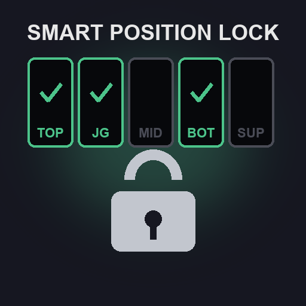

# Smart Position Lock — 智能位置锁定（团战经理 2 / Teamfight Manager 2）

双方只会选还能放进剩余空位的英雄，AI 队伍选完后由本 Mod 把每个英雄安排到它能打的位置上。**不用任何设置**：装上就生效。原生 Mod（稳定版 Mod API，游戏 0.6 及以上；给 AI 队伍分路需要游戏 **0.6.4** 及以上）。

- **英雄能打的位置自动判断**：
  - 英雄联盟英雄（league Mod）：内置全部 155 个英雄的英雄联盟官方主位置（[`presets/league_positions.ini`](presets/league_positions.ini)），列在第一个的是它有得选时优先打的位置；
  - 其他英雄：选人卡片上游戏标注的两个主位置，加上本存档里它实际打过足够多的位置（大会比赛和单排都算）。卡片上的“主位置”是游戏统计的、这个英雄被用得最多的两个位置（游戏还没统计过的英雄一律显示“上路+打野”），不是英雄 Mod 设置的。主位置在你第一次打开选人界面时学会，存在 Mod 文件夹的 `positions.json` 里，之后 AI 之间的比赛也会用；
  - 你在 `settings.ini` 或 F7 面板里指定的位置优先于以上所有。
- **按整队判断**：不会同时选两个只能打上路的英雄；能打多个位置的英雄会被安排到还空着的位置上。
- **AI 选人**：AI 每一手只会选还能和已选的英雄一人一个位置放下的英雄，先选哪个位置都行。
- **AI 分路（游戏 0.6.4 及以上）**：AI 队伍选完五个英雄后，游戏原本按自己的判断（选手熟练度和它统计的英雄主位置）给选手分路，跟选人顺序无关——所以以前会出现选来打上路的盖伦被放去打辅助。现在由本 Mod 来分：每个英雄都放到它能打的位置上；能打多个位置时优先它的主位置；还有几种同样好的分法时，把英雄交给对它熟练度最高的选手（游戏里选手的英雄熟练度），最后才按选人顺序。熟练度只在这些同样好的分法之间挑，绝不会把英雄放到它不能打的位置。五个英雄都没有位置信息时仍由游戏来分。游戏 0.6.3 及以前没有这个接口，只能限制选人，分路还是游戏的。
- **选手熟练度从哪来**：选人时游戏会告诉 Mod 双方上场的五名选手；本存档比赛里出现过的选手也会记下。Mod 在经营界面和选人界面读取这些选手的英雄熟练度（每帧最多两名，不影响流畅度），上场的选手每 10 分钟重读一次；换存档重新读。一支队伍里有选手还没读到时，这支队伍按没有熟练度的规则分（主位置，再按选人顺序）。
- **你自己按整队判断**：你选人时，放不进剩余空位的英雄卡片会盖上一把锁，点不了；你可以先选再在换位阶段调整（你自己队伍的分路由你决定）。
- **禁用不受限制。没有任何合适的英雄时自动全部放开**，选人永远不会卡住。不知道你是蓝方还是红方时，你这边什么都不锁。
- 和 **Patch Meta AI** 一起用：它的推荐会跳过被锁住的英雄。以前 Patch Meta AI 学到的英雄主位置会自动接过来。
- 不要和另一个位置锁定 Mod（Champion Position Lock）同时开：两个锁会叠加，英雄要同时满足两边才能选。

## 游戏内设置面板（F7）

任何界面按 **F7** 打开（再按 F7、Esc 或右上角 ✕ 关闭）：
- 上面四个开关：总开关、锁定 AI 选人和分路、锁定我自己选人、参考存档战绩；
- 下面是选人界面出现过的所有英雄（每页 24 个，◀ ▶ 翻页）：点某个位置就打开/关闭这个英雄能打的这个位置（绿色 = 能打）。改过的英雄标“手动”，点 ↺ 恢复；英雄联盟英雄标“内置”，其他英雄标“自动”。

每次点击立即生效，并自动写进 `settings.ini`（文件里的其他内容和注释都保留）。

## 设置：`settings.ini`

第一次运行时在 Mod 文件夹里自动生成，改完保存几秒内生效，不用重启。上面的面板改的就是这个文件，也可以直接编辑。

| 段落 | 键 | 默认 | 作用 |
|---|---|---|---|
| `[lock]` | `enabled` | on | 总开关 |
| | `ai` | on | 限制 AI 选人，并给 AI 队伍分路 |
| | `player` | on | 限制你自己选人（锁住放不下的卡片） |
| `[history]` | `history` | on | 把本存档里实际打过的位置也算进去；`off` = 只用卡片上的两个主位置（内置的英雄联盟英雄不受影响） |
| | `min_games` / `share` | 8 / 0.15 | 英雄至少打过这么多场、某位置占比至少这么多，才算它能打这个位置 |
| `[positions]` | 英雄 id | （空） | 手动指定位置，例如 `ahri=Mid,Support`（第一个是优先位置），完全替代内置位置和自动判断 |

## 英雄联盟英雄（league Mod）

league Mod 没有给英雄设置位置，游戏也还没有它们的统计，选人卡片上显示的大多是“上路+打野”，自动判断用不上。1.3.0 起 Mod 内置了全部 155 个英雄的英雄联盟官方主位置（[`presets/league_positions.ini`](presets/league_positions.ini)，每行后面有中文名），**不用再复制到 `settings.ini`**。以前复制过的照旧有效（`settings.ini` 优先）；想改哪个英雄，在 F7 面板里点，或者把它那一行复制到 `settings.ini` 的 `[positions]` 段再改。

## 出问题时

Mod 文件夹里的 `diag.log` 记录了 Mod 读到了什么，以及锁有没有起作用：
- `[draft]`：AI 每一手选人时还空着哪些位置、锁掉了哪些英雄；
- `[seat]`：AI 队伍选完后，按选人顺序列出它的英雄和各自能打的位置，箭头后是本 Mod 给它们分的位置和选手（方括号里是选手和他对这个英雄的熟练度；放不下时标出谁打了别的位置），最后说明熟练度有没有用上、是不是它决定了分法；另有一行核对游戏给的选手顺序是不是按位置排的（每名选手是否坐在他最擅长的位置上）；
- `[athletes]`：读到的第一名选手（熟练度最高的几个英雄、最擅长的位置）和读完了多少名选手；
- `[check]`：选人界面上每一方选的英雄能不能一人一个位置放下；
- `[result]`：本次游戏里打完的每场大会比赛，每个英雄实际打了哪个位置（换位之后的最终结果）。
每次启动游戏重写，上一次的保留为 `diag.prev.log`。

## English

Teams only pick champions that can still take one of their open positions, and AI teams play them there - nothing to set up. A champion's positions are, first found: your own list in `settings.ini` (`[positions]`, e.g. `ahri=Mid,Support`, or press **F7** in game for a settings panel that writes it); the built-in official main positions of all 155 League of Legends champions (`presets/league_positions.ini`); otherwise its two main positions as the game shows them on its ban/pick card - the positions the game has seen it played in most (Top + Jungle while it has seen nothing), not something a champion mod sets - learned on the ban/pick screen and kept in `positions.json`, plus every position it has really played in your save (`min_games` games, `share` of them there). The first position of a list is the champion's main one.

- **Picks.** A pick is legal when the team's picks and the candidate can still be seated one per position, in any pick order. The AI's picks are held to it by a draft score hook; your own by a lock over each card that does not fit, which takes the click. Bans are free, and when nothing on offer fits, everything does - a draft never gets stuck.
- **Positions (game 0.6.4+).** Once an AI team's picks are in, the game seats them on its players' lanes by its own judgement (player proficiency and its champion statistics), whatever the pick order - a Garen picked for top could end up in support. The mod now seats them itself through the draft hook's `decide_positions` (stable ABI level 10): every champion in a position it can play, its main position when it has a choice; of seatings equally good by those two, the one that gives each champion to the fielded player who plays it best (the game's champion proficiency), then pick order. Proficiency only chooses between equally good seatings - it never seats a champion off its positions. When nothing is known about any of the five, the game's seating stays. Older games have no such hook: the mod still loads there (it declares the baseline ABI level) and holds the picks only. Your own team's lanes are yours to set in the swap phase.
- **Where the proficiency comes from.** The draft hook cannot read records, so it notes every line-up the game shows it (`ally_athletes` / `enemy_athletes`, lane-slot order), and the save's competition matches add their players; the client reads those players' `champion_proficiency` and position ratings on the management screens and the ban/pick screen (at most two a frame), fielded players again every 10 minutes, everything again for another save. A team with a player not read yet is seated as if no player were known.
- `diag.log` shows `[draft]` (each AI pick), `[seat]` (each AI team's seating, with each player and his proficiency with his champion, and a check that the line-up is in lane-slot order), `[athletes]` (what the player records gave), `[check]` and `[result]` (where every champion really played).
- Build with `cargo build --release` (Windows) or `tools/build.sh` (packages `dist/smart_position_lock-<version>.zip`).
- MIT licensed. `vendor/mod-api-stable` is TeamSamoyed's SDK (game 0.6.5, ABI level 10: 0.6.4's plus the frozen abi_level_10.txt), unmodified.
